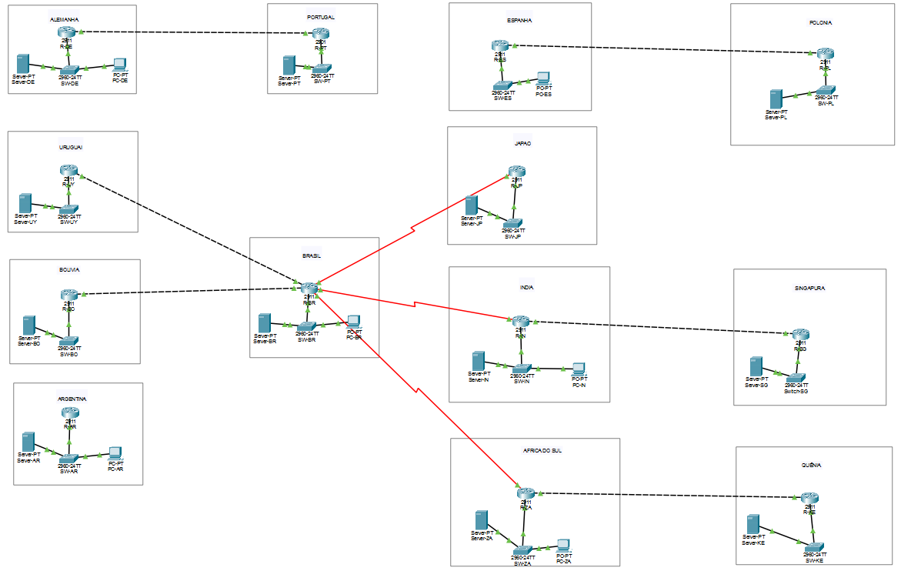

# Dados apurados no Cisco Packet Tracer: Preditor de Falhas na Rede

Registro dos resultados do projeto montado no Packet Tracer, guardado junto do arquivo `.pkt`.

| Campo | Informação |
|---|---|
| Disciplina | Redes de Computadores, Profa. Denise Braito, Centro Universitário Braz Cubas |
| Projeto | Projeto Integrador, Preditor de Falhas (protocolo ICMP), grupo 16 |
| Repositório | https://github.com/g-tavares14/preditor-de-falhas-ml |
| Arquivo do projeto | [Preditor_Falhas_Redes.pkt](Preditor_Falhas_Redes.pkt) |
| Dados até | 17/10/2026 |
| Equipe / RGMs | (preencher com nomes e RGMs de todos os integrantes) |

## 1. Situação do projeto

| Etapa | Descrição | Situação | O que já existe |
|---|---|---|---|
| 1 | Planejamento da topologia | **Concluída** | 13 países, 12 rotas, 44 equipamentos, IPs definidos |
| 2 | Montagem e cabeamento | **Concluída** | Equipamentos nomeados e cabos ligados; arquivo `.pkt` salvo |
| 3 | Configuração dos hosts | **Concluída** | 18 hosts conferidos com `ipconfig /all` |
| 4 | Configuração dos roteadores (OSPF) | **Concluída** | 13 roteadores; R-BR com 5 vizinhos em FULL |
| – | Validação das 12 rotas (ping) | **Concluída** | As 12 rotas respondem (TTL 128 ou 126) |
| 5 | Simulation Mode (ARP, Ethernet, ICMP) | **Concluída** | Trajeto Probe-BR → Alvo-UY capturado |
| 6 | Coleta de medições (baseline, Período A) | **Em andamento** | Planilha pronta; 3 de 240 rajadas coletadas |
| 7 | Cenários de teste (Período B) | Pendente | — |
| 8 | Classificação OK / RISCO / FALHA | Pendente | — |
| 9 | Validação Real × Packet Tracer | Pendente | — |

## 2. Topologia

A rede reproduz as **12 rotas de país** do repositório: cada país tem 1 roteador (2911) e 1 switch (2960), e cada rota entre países é um enlace entre os dois roteadores. São 13 países e 44 equipamentos: 13 roteadores, 13 switches, 6 PCs **Probe** (origem do ping) e 12 servidores **Alvo** (destino).

### 2.1 Equipamentos por país

| País | Região | Roteador (2911) | Switch (2960) | Alvo (Server) | Probe (PC) | Módulo serial |
|---|---|---|---|---|---|---|
| BR · Brasil | América do Sul | R-BR | SW-BR | Alvo-BR | Probe-BR | 2× HWIC-2T (slots 2 e 3) |
| UY · Uruguai | América do Sul | R-UY | SW-UY | Alvo-UY | — | nenhum |
| BO · Bolívia | América do Sul | R-BO | SW-BO | Alvo-BO | — | nenhum |
| AR · Argentina | América do Sul | R-AR | SW-AR | Alvo-AR | Probe-AR | nenhum |
| DE · Alemanha | Europa | R-DE | SW-DE | Alvo-DE | Probe-DE | nenhum |
| PT · Portugal | Europa | R-PT | SW-PT | Alvo-PT | — | nenhum |
| ES · Espanha | Europa | R-ES | SW-ES | — | Probe-ES | nenhum |
| PL · Polônia | Europa | R-PL | SW-PL | Alvo-PL | — | nenhum |
| ZA · África do Sul | África | R-ZA | SW-ZA | Alvo-ZA | Probe-ZA | 1× HWIC-2T (slot 3) |
| KE · Quênia | África | R-KE | SW-KE | Alvo-KE | — | nenhum |
| IN · Índia | Ásia | R-IN | SW-IN | Alvo-IN | Probe-IN | 1× HWIC-2T (slot 3) |
| SG · Singapura | Ásia | R-SG | SW-SG | Alvo-SG | — | nenhum |
| JP · Japão | Ásia | R-JP | SW-JP | Alvo-JP | — | 1× HWIC-2T (slot 3) |

### 2.2 Endereçamento IPv4 das LANs

| País | Rede LAN | Gateway (R, g0/0) | Alvo (.10) | Probe (.20) |
|---|---|---|---|---|
| BR · Brasil | 192.168.10.0/24 | 192.168.10.1 | 192.168.10.10 | 192.168.10.20 |
| UY · Uruguai | 192.168.11.0/24 | 192.168.11.1 | 192.168.11.10 | — |
| BO · Bolívia | 192.168.12.0/24 | 192.168.12.1 | 192.168.12.10 | — |
| AR · Argentina | 192.168.13.0/24 | 192.168.13.1 | 192.168.13.10 | 192.168.13.20 |
| DE · Alemanha | 192.168.20.0/24 | 192.168.20.1 | 192.168.20.10 | 192.168.20.20 |
| PT · Portugal | 192.168.21.0/24 | 192.168.21.1 | 192.168.21.10 | — |
| ES · Espanha | 192.168.22.0/24 | 192.168.22.1 | — | 192.168.22.20 |
| PL · Polônia | 192.168.23.0/24 | 192.168.23.1 | 192.168.23.10 | — |
| ZA · África do Sul | 192.168.30.0/24 | 192.168.30.1 | 192.168.30.10 | 192.168.30.20 |
| KE · Quênia | 192.168.31.0/24 | 192.168.31.1 | 192.168.31.10 | — |
| IN · Índia | 192.168.40.0/24 | 192.168.40.1 | 192.168.40.10 | 192.168.40.20 |
| SG · Singapura | 192.168.41.0/24 | 192.168.41.1 | 192.168.41.10 | — |
| JP · Japão | 192.168.42.0/24 | 192.168.42.1 | 192.168.42.10 | — |

Máscara /24 = 255.255.255.0. Sem DNS e sem IPv6. Endereços e OSPF são decisões de montagem do grupo: o repositório define países e rotas, não endereços.

### 2.3 Enlaces entre roteadores

| ID | Rota | Escopo | Rede /30 | Ponta A | Ponta B | Cabo |
|---|---|---|---|---|---|---|
| L1 | BR → UY | Regional | 10.0.1.0/30 | R-BR g0/1, 10.0.1.1 | R-UY g0/1, 10.0.1.2 | Copper Cross-Over |
| L2 | BR → BO | Regional | 10.0.2.0/30 | R-BR g0/2, 10.0.2.1 | R-BO g0/1, 10.0.2.2 | Copper Cross-Over |
| L3 | DE → PT | Regional | 10.0.3.0/30 | R-DE g0/1, 10.0.3.1 | R-PT g0/1, 10.0.3.2 | Copper Cross-Over |
| L4 | ES → PL | Regional | 10.0.4.0/30 | R-ES g0/1, 10.0.4.1 | R-PL g0/1, 10.0.4.2 | Copper Cross-Over |
| L5 | ZA → KE | Regional | 10.0.5.0/30 | R-ZA g0/1, 10.0.5.1 | R-KE g0/1, 10.0.5.2 | Copper Cross-Over |
| L6 | IN → SG | Regional | 10.0.6.0/30 | R-IN g0/1, 10.0.6.1 | R-SG g0/1, 10.0.6.2 | Copper Cross-Over |
| L7 | BR → JP | Longo | 10.0.11.0/30 | R-BR s0/3/0, 10.0.11.1 | R-JP s0/3/0, 10.0.11.2 | Serial DCE (lado DCE no R-BR) |
| L8 | BR → IN | Longo | 10.0.12.0/30 | R-BR s0/3/1, 10.0.12.1 | R-IN s0/3/0, 10.0.12.2 | Serial DCE (lado DCE no R-BR) |
| L9 | BR → ZA | Longo | 10.0.13.0/30 | R-BR s0/2/0, 10.0.13.1 | R-ZA s0/3/0, 10.0.13.2 | Serial DCE (lado DCE no R-BR) |

Dentro de cada país: SW Gi0/1 ↔ R g0/0, SW Fa0/1 ↔ Alvo e SW Fa0/2 ↔ Probe (cabo direto). As rotas curtas (BR→BR, DE→DE, AR→AR) ficam na mesma LAN.

## 3. Roteamento (OSPF)

OSPF processo 1, área 0, nos 13 roteadores; nos lados DCE, `clock rate 128000`. No nosso Packet Tracer os módulos HWIC-2T caíram nos slots 2 e 3, então as seriais se chamam `s0/2/x` e `s0/3/x`. O comando `show ip ospf neighbor` no R-BR mostrou 5 vizinhos em FULL:

| Vizinho (Router ID) | País | Interface do R-BR | Estado |
|---|---|---|---|
| 192.168.11.1 | UY | Gi0/1 | FULL |
| 192.168.12.1 | BO | Gi0/2 | FULL |
| 192.168.42.1 | JP | Serial0/3/0 | FULL |
| 192.168.30.1 | ZA | Serial0/2/0 | FULL |
| 192.168.40.1 | IN | Serial0/3/1 | FULL |

## 4. Teste das 12 rotas (ping de 4 pacotes)

| # | Rota | Escopo | Executado em | Comando | Recebidos | TTL | Tempo (ms) | Observação |
|---|---|---|---|---|---|---|---|---|
| 1 | BR → BR | Curto | Probe-BR | `ping 192.168.10.10` | 4/4 | 128 | 0 a 0 | Mesma LAN (SW-BR); <1ms |
| 2 | BR → UY | Regional | Probe-BR | `ping 192.168.11.10` | 3/4 | 126 | 0 a 0 | 1º pacote perdido (ARP); 2 roteadores no caminho |
| 3 | BR → BO | Regional | Probe-BR | `ping 192.168.12.10` | 3/4 | 126 | 0 a 10 | 1º pacote perdido (ARP) |
| 4 | BR → JP | Longo | Probe-BR | `ping 192.168.42.10` | 3/4 | 126 | 1 a 12 | 1º pacote perdido (ARP); enlace serial |
| 5 | BR → IN | Longo | Probe-BR | `ping 192.168.40.10` | 3/4 | 126 | 1 a 11 | 1º pacote perdido (ARP); enlace serial |
| 6 | BR → ZA | Longo | Probe-BR | `ping 192.168.30.10` | 3/4 | 126 | 1 a 1 | 1º pacote perdido (ARP); enlace serial |
| 7 | DE → DE | Curto | Probe-DE | `ping 192.168.20.10` | 4/4 | 128 | 0 a 0 | Mesma LAN (SW-DE); <1ms |
| 8 | DE → PT | Regional | Probe-DE | `ping 192.168.21.10` | 4/4 | 126 | 0 a 12 | Sem perda (ARP já aquecido); 2 roteadores no caminho |
| 9 | AR → AR | Curto | Probe-AR | `ping 192.168.13.10` | 4/4 | 128 | 0 a 0 | Mesma LAN (SW-AR); <1ms |
| 10 | ES → PL | Regional | Probe-ES | `ping 192.168.23.10` | 3/4 | 126 | 0 a 1 | 1º pacote perdido (ARP); 2 roteadores no caminho |
| 11 | ZA → KE | Regional | Probe-ZA | `ping 192.168.31.10` | 3/4 | 126 | 0 a 0 | 1º pacote perdido (ARP); 2 roteadores no caminho |
| 12 | IN → SG | Regional | Probe-IN | `ping 192.168.41.10` | 3/4 | 126 | 0 a 1 | 1º pacote perdido (ARP); 2 roteadores no caminho |

- **TTL 128** indica a mesma LAN (0 roteadores). **TTL 126** indica 2 roteadores no caminho.
- A perda de 25% nas rotas entre países é **só o primeiro pacote**, que espera o ARP no roteador do destino. Não é falha da rede.
- Na coleta, faça um ping de aquecimento antes de cada rajada para o ARP não distorcer o baseline.

## 5. Simulation Mode (Probe-BR → Alvo-UY)

| Onde | O que vemos | Campos principais |
|---|---|---|
| PC-BR (saída) | ARP request em broadcast pelo gateway | Destino: Broadcast |
| PC-BR (entrada) | ARP reply | Origem 192.168.10.1 (MAC 000C.8589.4901) |
| PC-BR (saída) | ICMP Echo Request | MAC destino 000C.8589.4901 (R-BR g0/0); tipo 0x0800; **TTL 128**; ICMP tipo 8 |
| R-BR (saída) | ICMP roteado pela g0/1 | MAC origem 000C.8589.4902; MAC destino 0005.5E08.BE02; **TTL 127** |
| R-UY (saída) | ICMP sem cabeçalho Ethernet | **TTL 126**; MAC do Alvo-UY ainda sem cache ARP |
| SW-UY / Server-UY | ARP request do R-UY | Destino FFFF.FFFF.FFFF; origem 192.168.11.1; alvo 192.168.11.10 |
| Server-UY (saída) | ARP reply | MAC 00D0.977E.021A; destino 0005.5E08.BE01 |

No R-BR, o quadro que chegou pela g0/0 é desencapsulado até a camada 3; o roteador consulta a tabela de rotas, escolhe a g0/1 e encapsula o pacote em um novo quadro, com outros MACs. Os IPs não mudam e o TTL cai de 128 para 127 e 126. Como o R-UY ainda não conhecia o MAC do Alvo-UY, ele fez o ARP antes de entregar o ICMP, o que explica o primeiro ping perdido.

## 6. Coleta do baseline (Período A)

**Situação: em andamento, 3 de 240 rajadas (1,25%).** As 3 rajadas são do fluxo `Probe-BR|192.168.10.10` (rota BR → BR). Meta: 20 rajadas de 3 pacotes (`ping -n 3`) para cada um dos 12 fluxos.

| Rajada | rtt1 (ms) | rtt2 (ms) | rtt3 (ms) | latencia_ms | jitter_ms | timestamp (UTC) |
|---|---|---|---|---|---|---|
| 1 | 0,5 | 0,5 | 0,5 | 0,50 | 0,00 | 2026-10-17T18:47:11Z |
| 2 | 1 | 0,5 | 0,5 | 0,67 | 0,25 | 2026-10-17T18:49:47Z |
| 3 | 0,5 | 0,5 | 12 | 4,33 | 5,75 | 2026-10-17T18:50:46Z |

- `<1ms` é anotado como **0,5 ms**, porque `rtt = 0` é timeout no repositório. Pacote sem resposta fica vazio (`T`), nunca 0.
- **Jitter** = média de |Δrtt| entre pings consecutivos que responderam. **Latência** = média dos RTT válidos da rajada.
- Os horários foram ajustados à mão (15h47 de Brasília = 18:47 UTC) e são aproximados; servem para ordenar as rajadas.
- Adaptação: 20 rajadas por fluxo, abaixo do piso de 1.500 RTT válidos do repositório.

## 7. Problemas encontrados e soluções

| # | Problema | Causa | Solução |
|---|---|---|---|
| 1 | Seriais com nomes diferentes dos previstos | Os HWIC-2T caíram nos slots 2 e 3 | Usar `s0/2/x` e `s0/3/x` |
| 2 | Enlace da Índia down/down | IP configurado na porta errada | IPs movidos para as portas dos cabos (`s0/3/1` no R-BR e `s0/3/0` no R-IN) |
| 3 | JP e ZA com serial up/up, mas ping 0/5 e sem OSPF | Cabos trocados em relação ao IP configurado | `show cdp neighbors` mostrou os vizinhos; IPs do R-BR trocados |
| 4 | `% 10.0.11.0 overlaps with Serial0/2/0` | IPs trocados sem remover os anteriores | `no ip address` nas duas portas antes de reatribuir |
| 5 | `Invalid input detected` ao colar comandos | Prompt `R-BR>` (sem `enable`) | Começar todo bloco com `enable` |

## 8. O que falta

- Coletar as 237 rajadas restantes do baseline (12 fluxos × 20, menos as 3 feitas).
- Cenários de teste do Período B (latência elevada, ICMP bloqueado, queda de enlace).
- Rotular o Período B em OK / RISCO / FALHA com as regras da Tarefa 2 do repositório.
- Tabela de validação real × Packet Tracer.
- Captura da topologia final do PT e prints do Simulation Mode.

---

*Dados obtidos no Cisco Packet Tracer (arquivo Preditor_Falhas_Redes.pkt) até 17/10/2026, para o repositório g-tavares14/preditor-de-falhas-ml.*
